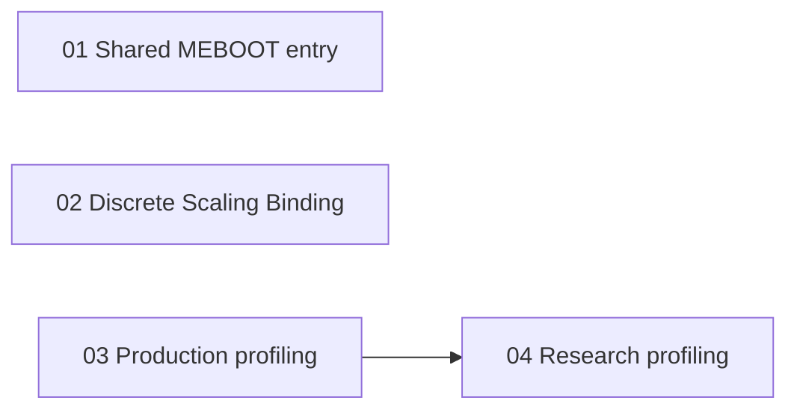

# Bootstrap Contract Deepening: Execution Tickets

**Status:** completed
**Approved:** 2026-10-19; user confirmed the testing seams, ticket scope and dependencies.
**Source:** [Specification](../../docs/specs/0005-bootstrap-contract-deepening.md)
**Tracker:** Local fallback; GitHub CLI unavailable on 2026-10-19.
**Initial frontier:** Tickets 01, 02 and 03; ticket 04 was blocked by 03.
**Completed:** 2026-10-19. All four tickets are implemented and verified.
**Evidence:** [Validation report](../../docs/validation/bootstrap-contract-deepening-20261019.md)
and [execution record](execution.md).

| Ticket | Delivers | Blocked by |
| --- | --- | --- |
| [01: Shared MEBOOT entry](issues/01-shared-meboot-entry.md) | Identity19 and Discrete MEBOOT use one entry-to-fork implementation, verified through BootContext and existing observations. | None |
| [02: Prepared discrete Scaling Binding](issues/02-prepared-discrete-scaling-binding.md) | Preparation derives and validates a coherent discrete output contract without a second caller-side schedule formula. | None |
| [03: Shared production profiling](issues/03-shared-production-profiling.md) | Production ProfileBoot uses one timing implementation with existing result and stage semantics. | None |
| [04: Shared research profiling](issues/04-shared-research-profiling.md) | Both discrete research profilers reuse the timing implementation and retain detailed observations. | 03 |

Recommended serial order: 01, 02, 03, 04. Tickets 01, 02 and 03 have no
prerequisites; only ticket 04 needs an implementation delivered by another
ticket. Coordinate overlapping edits when working concurrently.

The primary test seam is BootContext. The research test seam is the existing
discrete adapter interface. A narrow internal timing test is appropriate only
for resource-lifecycle cases that cannot be exercised deterministically through
those existing interfaces.

Each ticket includes its own behavior and validation. There is no separate
test-only acceptance ticket. Completion requires recorded build and test
results for the ticket's affected behavior.

Work the approved frontier. On GitHub
publication, create the specification as the parent issue, publish the four
tickets in dependency order, replace local references with issue identifiers
and add the native 04-blocked-by-03 relationship where available. Do not close
the parent issue as part of publishing or completing an individual ticket.
