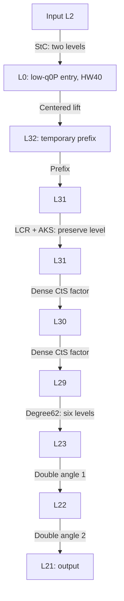

# Identity19 verification: HW40 / K20 / degree62 / DA2

The consolidated production implementation is controlled by ADR-0008. Its
nine-test regression and public `BootContext::Boot` timing run are recorded
in `docs/evidence/identity19/`. Both routes have numerical checks from one
prepared keyset each; MEBOOT has 30 measured refreshes from one keyset. Three
independent keysets and a paired baseline remain unqualified.

Earlier selected-implementation measurements remain separately labeled in
`docs/evidence/identity19-baseline/`. The independent stage oracle is
`unittest/fixtures/identity19-stage-oracle.json.gz`; pinned reference inputs
are under `parameters/reference/`. The baseline manifest records their hashes.

Owner-directed correction on 2026-10-15. The selected Joint route uses a
42-bit q0, low-q0P entry, extension8 and HW40. Its effective secret dimension
is 65536/8 = 8192. The historical classic HW256/extension16 entry model is
inapplicable. Ordinary's coefficients, moduli, K16 and DA3 are unchanged.

## Parameter and level contract

| Setting | Selected Joint |
| --- | --- |
| Subring secret | HW40, effective dimension8192 |
| Entry | q0=42 bits, one entry P, base-16 decomposition |
| EvalMod | K20, actual degree62, DA2, no inverse polynomial |
| Polynomial input | L29 |
| Polynomial output | L23 |
| Double-angle outputs | L22, L21 |
| Application output | L21, scale2^40, 19 levels above the L2 input |



The independent bypass starts at L29, uses eight transform factors and ends
at L21. Correction consumes L22 to L21. CtS retains its original start,
temporary prefix, LCR modulus and AKS keys. The initially added L29-to-L28
drop discarded the DA2 level saving and has been removed. Output level is
now derived from polynomial depth and the DA count, rather than fixed at L20
for both routes. Ordinary still outputs L20.

Lattigo's CosDiscrete literal retains `Mod1Degree=63` as its approximation
budget; the exported even polynomial has 63 coefficients and actual degree62.
The native evaluator preserves every nonzero coefficient, including its tail.

## Scaling binding

Changing DA3 to DA2 changes the number of subsequent squarings. The native
half-return-gain binding requires multiplying the initial polynomial and
sqrt2pi by `0.5^(1/2^DA)`: DA2 uses `2^(-1/4)`, rather than DA3's
`2^(-1/8)`. The resulting native sqrt2pi is `0.37556273865455964`.

The target polynomial scale is backsolved from the L21 output scale:
start from 2^58, then take `sqrt(target*q22)` and `sqrt(target*q23)`.
Forward DA2 consumes q23 followed by q22. Ordinary's three-step calculation
is equivalent to its previous q21/q22/q23 backsolve.

The pinned original reference export is unchanged. A separate unretuned K20
polynomial export is in `parameters/identity19_mod1_reference.json`,
with SHA256 checked by `unittest/tools/import_boot_parameters.py`.
`unittest/tools/export_identity19_mod1.go` reproduces its numeric contents
from the pinned reference module. The importer applies the native gain once,
preserves integer moduli without a floating-point JSON round trip and emits
both the selected JSON and C++ profile. Repeated import is byte-identical.

## Domain escape and lattice screening

The domain-escape model counts HW40+1 = 41 summands. It does not use 8192 or
the old HW256 as the summand count. Under the existing independent centered
Uniform(-1/2,1/2) model, the whole-refresh two-sided union factor is 2^18.

| Threshold for the 41-term sum | log2 Chernoff upper bound |
| --- | ---: |
| K=20 | -183.5091355 |
| K-1/2-2^-10 = 19.4990234375 | -142.4513995 |

The second row includes a half-cell margin and a fractional guard. Both meet
the -128 target under that model. This is a conditional analytic calculation,
not an empirical observation of 2^-128 events, and does not bound lattice attacks
or polynomial approximation error.

The production audit is recorded in `docs/evidence/identity19/security.json`.
It binds the current profile hash, every Q/P integer and the entry domain to
the immutable reference security plan, and verifies the hashes and inputs of
six attack records per domain. The upstream configuration keeps its original
`identity16-18-joint` name; renaming the production route does not rename this
external evidence. The earlier binding remains in
`docs/evidence/identity19-baseline/identity19-security-20261015.json`.

| Domain | Dimension / HW | Modulus exposure | Lowest classical log2 cost |
| --- | --- | --- | ---: |
| Entry | 8192 / 40 | q0*Pentry, log2=61.58496382 | 136.3798407 |
| Main evaluation keys | 65536 / 2048 | exact normal Q*P, log2=1715.00995021 | 132.4669487 |

Entry uses sigma3.2 and 720896 samples (11 full-ring entry digits); the main
screen uses unlimited samples. These are reused, configuration-matched classical
heuristic estimates from the 2026-10-07 reference evidence at lattice-estimator
revision `53da5982597709ba0fdf94ea37a84d822310fd84`, not new estimator runs or
unconditional/quantum security proofs. K and DA do not change either public
key modulus domain.

To recheck against the adjacent reference repository from the Cheddar root:

```sh
python3 unittest/tools/audit_identity19.py \
  --security-package ../paper1-linear-bootstrap/paper/evidence/measurements/submission-security-20261007 \
  --output build/validation/identity19-security.json
```

Without `--security-package`, the tool checks the native parameter contract
and conditional domain-escape bound only.

## Numerical verification

The analytic sine comparison independently checks the new polynomial near
every covered integer from -19 through19, including fractional offsets
of +/-0.5/1024. Its maximum error in Mod1 output units is `7.8941e-7`,
below 2^-18. This complements the encrypted-versus-plaintext arithmetic
test; agreement with the same coefficients alone would not verify their gain.

The consolidated L21 suite passed all nine tests, including both refresh routes,
the independent matrix oracle, exact JSON/native parameter contracts and
prefix residue checks and rejection of mismatched core parameters. The observed
Joint Mod1 levels are L29, L23, L22, L21.
Both correction and bypass also finish at L21, and the application output
scale remains 2^40.

| Joint input | Maximum complex error at L21 |
| --- | ---: |
| Mixed | 2.068579202263353e-6 |
| Signed grid | 2.45439565125591e-6 |
| Zero | 6.221067233931447e-7 |
| Endpoints | 2.9335493558086487e-6 |
| Independent | 1.6280688434586447e-6 |

Every pattern is below `2^-18 = 3.814697265625e-6`. Joint encrypted Mod1
versus plaintext arithmetic error was `1.352634319755239e-9`. Ordinary still
outputs L20/scale2^40; its maximum error across the same five patterns was
`1.774872792334959e-6`. Logs and XML results are in
`docs/evidence/identity19/verified.log` and `verified.xml`.

The public `BootContext::Boot` performance check used five warmups and 30
measured refreshes on an RTX 5060 Ti. Median wall time was `254.229839 ms`;
median GPU event time was `243.569732666 ms`. Preparation took `51.844744199 s`;
rotation and AKS key preparation took `7.074978985 s`. The latter starts
after `UserInterface` construction and excludes its basic-key generation.
Prepared live/peak pool memory was `13696557016 / 14308401216` bytes, or
approximately `12.76 / 13.33 GiB`. These are local observations, without a
paired baseline run or a claimed speedup. Raw samples are in
`docs/evidence/identity19/performance.log`.
An additional `ProfileBoot` call exercised the same public execution path and
recorded per-stage GPU events outside the 30 timed samples. The evidence
manifest includes the source digest, profile/oracle hashes and build log.

The follow-up broad operator run stopped during `basic_test` after more than
12 minutes without output; it produced no result for that test or the remaining
operator executables. It is not included among the nine passing MEBOOT tests.
The partial log is retained under `build/validation/meboot-operator-tests.log`.


