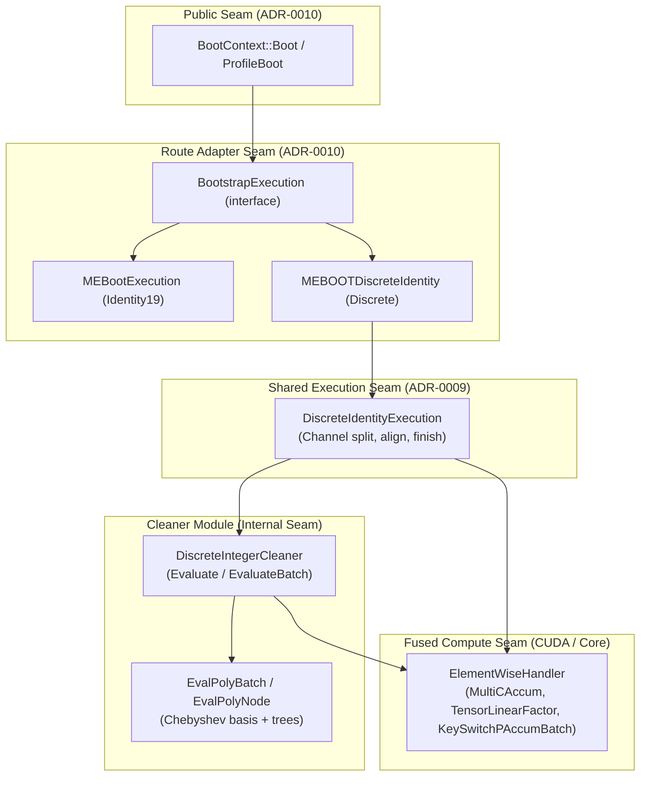
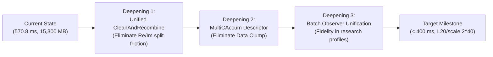

# Discrete MEBOOT Architecture & Deepening Review (2026-10-20)

**Scope**: Architectural analysis and deepening review of the Discrete MEBOOT route post-Phase 3 optimization (`e107da8...HEAD`). Controls: ADR-0009 (`Discrete EvalRound extension seam`), ADR-0010 (`Discrete MEBOOT as a BootContext route`), and Spec 0006 (`0006-discrete-meboot-latency.md`).

---

## 1. Architectural Seam Map & Depth Analysis

Applying the deep-module vocabulary (`Module`, `Interface`, `Implementation`, `Depth`, `Seam`, `Adapter`, `Leverage`, `Locality`):



### Module Evaluation Table

| Module | Interface Surface | Implementation Depth | Leverage | Locality | Depth Assessment |
| :--- | :--- | :--- | :--- | :--- | :--- |
| **`BootContext`** | Minimal (`Boot`, `ProfileBoot`) | High (manages parameter validation, key registry, dynamic route dispatch) | High | High | **Deep** (clean public entry) |
| **`MEBOOTDiscreteIdentity`** | Internal `BootstrapExecution` | High (orchestrates native entry, low CtS, bypass, finish) | High | High | **Deep** (adapter matches ADR-0010) |
| **`DiscreteIdentityExecution`** | Medium (`CleanInteger`, `AlignBypass`, `Finish`) | Medium (splits Re/Im channels, coordinates cleaner, finishes) | Medium | Medium | **Medium** (leaks channel coordination) |
| **`DiscreteIntegerCleaner`** | Medium (`Evaluate`, `EvaluateBatch`) | Very High (63-deg Remez extractor, chunked cubic refinement, recombination) | High | Medium | **Deepening Opportunity** (caller still splits Re/Im) |
| **`EvalPolyBatch`** | Medium (`Evaluate`, `EvaluateBatch`) | Very High (baby-step/giant-step, basis tree factoring, DAG traversal) | High | High | **Deep** (contains uncalled speculative batching) |
| **`ElementWiseHandler`** | Large (many vector views) | Extreme (fused register arithmetic, direct CUDA kernels) | Very High | High | **Shallow Interface, Deep Implementation** |

---

## 2. Friction Points & Fowler Smell Analysis

### Friction 1: Speculative Generality vs Physical Memory Hard Wall
- **Smell**: Speculative Generality.
- **Location**: `include/extension/EvalPoly.h:263` & `src/extension/EvalPoly.cpp:1373-1445` (`EvalPolyBatch<word>::EvaluateBatch`), plus `EvalPolyNode::EvaluateBatch` parameters `defer_root_moddown` and `deferred_accums`.
- **Root Cause Analysis**: `EvalPolyBatch::EvaluateBatch` was engineered to evaluate multiple channel inputs concurrently. However, in Discrete MEBOOT, a single channel holds 13 Chebyshev basis ciphertexts and 6 output trees at levels L28–L23 (~744 MB). Holding both channels concurrently pushes peak VRAM to ~16,100 MB, which **breaches the Windows WDDM physical ceiling of 15,385 MB** and induces catastrophic PCIe memory paging.
- **Architectural Consequence**: `DiscreteIntegerCleaner::EvaluateBatch` intentionally bypasses `extractor_->EvaluateBatch` and loops sequentially per channel (`for (size_t c = 0; c < num_channels; ++c)`). The multi-input polynomial batching code is currently dead code retained for research exploration.

### Friction 2: Subverted Interface Contracts (`const_cast` Eager Deallocation)
- **Smell**: Misleading Interface / Contract Breach.
- **Location**:
  - `src/extension/DiscreteIdentityBootstrap.cpp:222`: `const_cast<Ct &>(low) = Ct();`
  - `src/core/Context.cpp:424`: `const_cast<Ct &>(a).RemoveRx();`
- **Root Cause Analysis**: The WDDM memory budget requires releasing intermediate ciphertexts as early as possible (e.g. dropping `low` immediately after `SplitRealImag`). However, `CleanInteger` declares `const Ct &low`, forcing a `const_cast` to destroy the caller's parameter.
- **Architectural Consequence**: Subverts C++ const-correctness and creates dangerous hidden side-effects for callers who expect `low` to remain immutable.
- **Remedy**: Change interface signatures from `const Ct &low` to rvalue reference `Ct &&low` or accept ownership explicitly (`Ct low`).

### Friction 3: Duplicated Recombination Code & Shallow Cleaner Seam
- **Smell**: Duplicated Code.
- **Location**: `src/extension/DiscreteIntegerCleaner.cpp` (L188–204 in `EvaluateBatch` vs L270–286 in `Evaluate`).
- **Root Cause Analysis**: Setting up `MultiCAccum` for integer recombination (gathering 6 digit slice views, constructing `const_srcs_batch`, `c0_consts_batch`, and `dst_batch`) is copied verbatim between single-ciphertext `Evaluate` and batch `EvaluateBatch`.
- **Remedy**: Extract a shared private helper `RecombineDigitsMultiCAccum(...)`.

### Friction 4: Primitive Obsession in Fused Compute Interfaces
- **Smell**: Data Clumps / Primitive Obsession.
- **Location**: `ElementWiseHandler::MultiCAccum` and `Context::MultiCAccum`.
- **Description**: 5 raw nested vectors (`std::vector<std::vector<DvConstView<word>>> shared_ct_srcs`, `const_srcs_batch`, `init_ct_batch`, `c0_consts_batch`, and `dst_batch`) travel together across callers and GPU invocations.
- **Remedy**: Bundle into a typed struct `MultiCAccumBatchDescriptor<word>` that encapsulates view validation, modulus parity, and shape matching behind a compact interface.

### Friction 5: Diagnostic Observability Divergence
- **Smell**: Divergent Behavior under Observation.
- **Location**: `DiscreteIdentityExecution::CleanInteger` (`DiscreteIdentityBootstrap.cpp:225-245`).
- **Description**: When `observe != nullptr`, the code branches away from `EvaluateBatch` to serial `Evaluate`. As a result, research profiling runs do not measure the batched production pipeline (`RelinearizeBatch`, `RelinearizeRescaleBatch`, chunked cubic cleaning).
- **Remedy**: Support stage observation directly in `EvaluateBatch` so profiling faithfully benchmarks the production path.

---

## 3. Physical Hardware Boundary Constraints

On the primary validation GPU (NVIDIA RTX 5060 Ti 16 GB, Windows 11 WDDM):

```
+-------------------------------------------------------------------------------+
| Total Physical VRAM: 16,311 MB                                                |
| [OS / Desktop WDDM Display Overhead: ~1,027 MB]                               |
| [Usable Cheddar Physical VRAM Ceiling: 15,385 MB (Hard Bound)]                |
|   +-------------------------------------------------------------------------+ |
|   | Resident Evaluation Keys: 10,497 MB (Strictly Invariant)               | |
|   | Peak Workspace Temporaries: 4,803 MB (Post-Phase 3)                     | |
|   | Peak Cheddar Allocation: 15,300 MB                                      | |
|   | Safety Headroom to WDDM Paging: 85.15 MB                                | |
|   +-------------------------------------------------------------------------+ |
+-------------------------------------------------------------------------------+
```

1. **L2 Cache (32 MB) Invariant**:
   - Single-ciphertext ($Z=1$) NTT/INTT requires 12–16 MB, fitting 100% in L2 cache (> 2,000 GB/s bandwidth).
   - Multi-ciphertext batching across NTTs ($Z \ge 6$) inflates working sets to 72–144 MB, evicting L2 into DRAM (448 GB/s) and causing a 3× slowdown.
   - **Architectural Rule**: Keep NTT/INTT single-stream $Z=1$; batch only at the outer KeySwitch tensor multiply-accumulate stage (`MultiCAccum`).

2. **Windows WDDM Paging Cliff**:
   - Any temporary allocation exceeding 15,385 MB triggers Windows PCIe system memory paging, reducing throughput from 448 GB/s to 12 GB/s (37× drop).
   - Eager deallocation (`low = Ct()`, `aligned_high` copy removal, chunk size = 6 in cubic cleaning) is an essential architectural requirement.

---

## 4. Deepening Roadmap (Action Items)



1. **Deepen `DiscreteIntegerCleaner`**:
   - Provide a unified method `CleanAndRecombine(Ct &integer, Ct &&low, const Evk &mult_key, const Evk &conj_key)`.
   - Hide conjugation, real/imaginary separation, scale alignment, chunked cleaning, and imaginary unit multiplication entirely inside `DiscreteIntegerCleaner`.
   - Caller (`DiscreteIdentityExecution`) simply passes `low` and receives `integer`.
2. **Encapsulate `MultiCAccum` Batch Parameters**:
   - Introduce `MultiCAccumBatchDescriptor<word>` in `ElementWise.h`.
   - Convert raw view vector construction into builder methods (`AddWeightedInput`, `SetConstantOffset`, `SetOutput`).
3. **Unify Profiling and Production Paths**:
   - Extend `EvaluateBatch` to accept stage observers with channel tagging.
   - Ensure benchmark tools profile the exact fused kernels used in production.
4. **Prune Dead EvalPoly Interfaces**:
   - Clean up `defer_root_moddown` and `deferred_accums` in `EvalPolyNode::EvaluateBatch`.
   - Retain `EvalPolyBatch::EvaluateBatch` with explicit documentation on its memory envelope and VRAM prerequisites.
